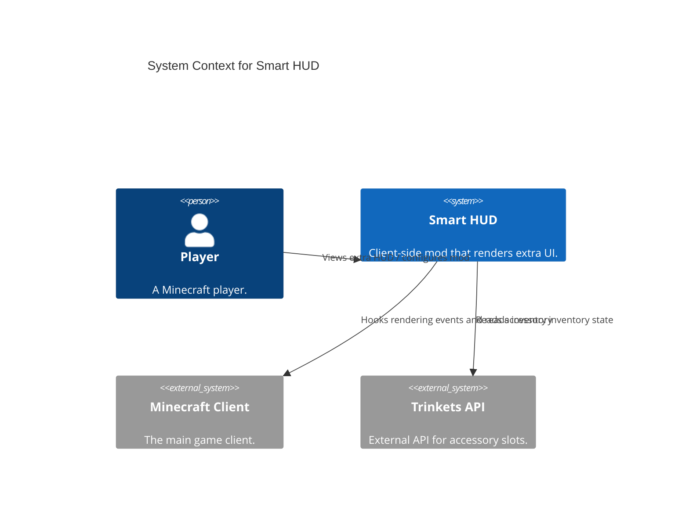
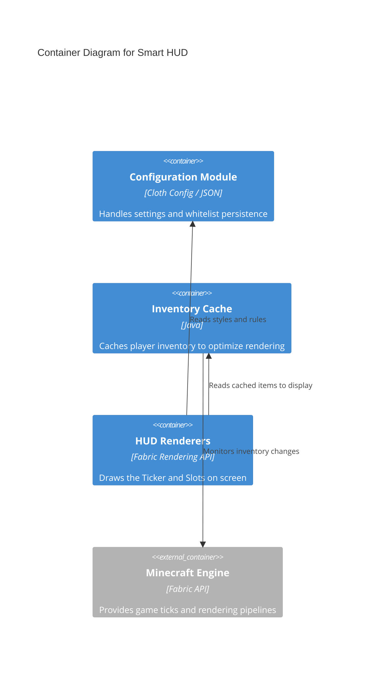

# Architecture Design (ISO/IEC/IEEE 42010:2022)

## 1. Introduction & Stakeholders
- **System Name:** Smart HUD
- **Context:** A Fabric mod for Minecraft 1.21.1 that renders additional HUD elements to provide utility without replacing core functionality.
- **Stakeholders:** Players (end-users), Modpack Creators (configuration), Developers (contributors).
- **Concerns:**
  - Performance: Must render seamlessly without hurting game FPS.
  - Compatibility: Must coexist with other HUD and inventory mods (e.g. Trinkets).
  - Configurability: Users must be able to visually customize their experience.

## 2. System Context (C4 Level 1)

## 3. Container Architecture (C4 Level 2)

## 4. Component Architecture (C4 Level 3)
- **Config Components:** `SmartHudConfig`, `SlotsConfig`, `TickerConfig`, `SlotWhitelist`
- **Cache Components:** `InventoryCache`, `TrinketCache`
- **Render Components:** `SlotRenderer`, `TickerRenderer`, `CubicBezierInterpolator`
- **Core Engine:** `SmartHudClient` (Entrypoint)

## 5. Architectural Views
- **Structural View:** The mod strictly isolates configuration models from rendering logic. Data flows from configuration JSON -> Memory Config POJO -> Renderer.
- **Behavioral View (Ticker):** An `ItemPickupMixin` injects into Minecraft's native pickup event. It passes the picked item to the `TickerQueue`. The `TickerRenderer` polls this queue and animates the items out of the screen using a bezier interpolator.

## 6. Quality Attributes (ISO 25010)
- **Performance Efficiency:** The `InventoryCache` prevents iterating over the entire player inventory on every single render frame.
- **Usability:** ModMenu integration ensures configuration is accessible directly inside the game client without restarting.
- **Maintainability:** Separation of styles and behavioral logic into dedicated configuration classes allows easy future expansions.
